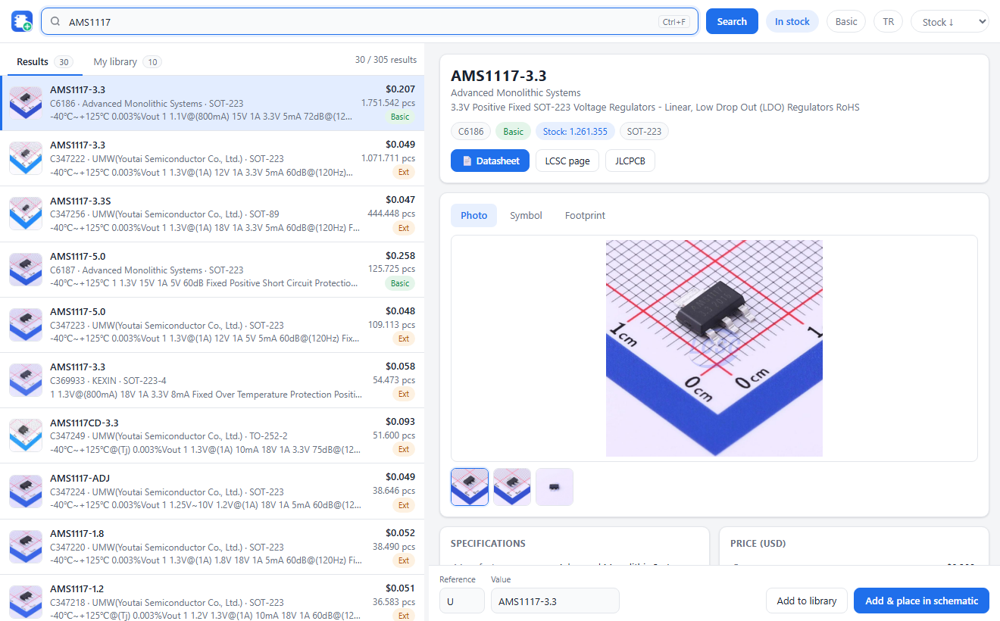
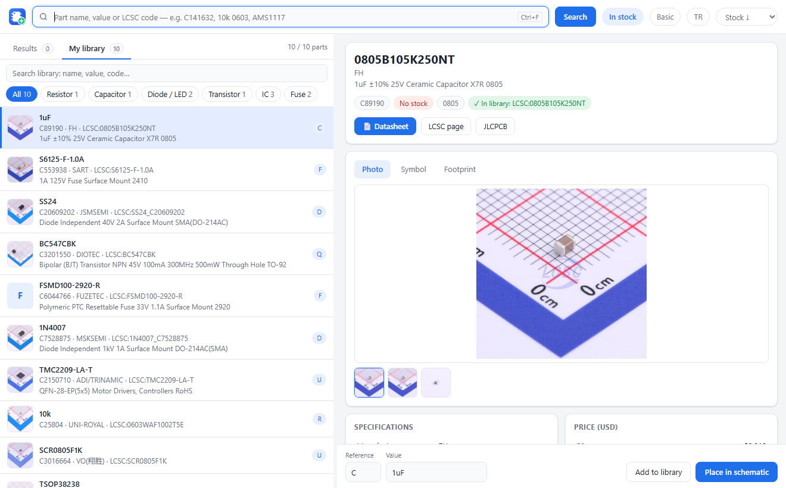

<p align="center"></p>

<h1 align="center">LCSC Part Importer for KiCad 10</h1>

<p align="center"><b>English</b> · <a href="README.tr.md">Türkçe</a></p>

Search LCSC / JLCPCB parts with **photos, symbol & footprint previews, specifications, prices and stock**,
add them to your KiCad library in one click and get them **attached to your cursor** in the schematic.
It brings the EasyEDA part-placing experience to KiCad.



## Features

- **Search** by part name (`AMS1117`), value + package (`10k 0603`) or LCSC code (`C141632`).
  In-stock / Basic filters, sort by stock or price.
- **Details panel:** photo gallery, symbol and footprint preview, specifications, price breaks,
  datasheet / LCSC / JLCPCB links.
- **One-click placement:** the part is imported into the `LCSC` library (symbol, footprint, 3D model),
  the schematic editor comes to the front and the symbol is attached to your cursor — just click to drop it.
- **My library:** imported parts with photos; filter by **resistor, capacitor, diode, transistor,
  IC…**, search, and place instantly without downloading again.
- **Parts without drawings:** if EasyEDA has no symbol/footprint for a code, other LCSC codes of the
  same part that do have drawings are suggested.
- **English and Turkish** interface (follows KiCad / Windows language, switch with the `EN`/`TR` button),
  light/dark theme, keyboard friendly (`Ctrl+F`, `↑ ↓`, `Enter`).



## Requirements

- **KiCad 10** on **Windows**
- Internet connection (data comes from LCSC/JLCPCB and EasyEDA)

Nothing else to install — no separate Python. The plugin installs the package it needs
(`easyeda2kicad`) through KiCad on first start.

## Installation

1. **Enable the KiCad API:** in the KiCad main window open **Preferences → Preferences… → Plugins**,
   tick **"Enable KiCad API"** and press **OK**.
2. **Download the package:** get `kicad-lcsc-importer-x.y.z.zip` from the
   [Releases](https://github.com/recepuysal/kicad-lcsc-importer/releases/latest) page. **Do not unzip it.**
3. **Install:** in the KiCad main window open **Tools → Plugin and Content Manager**, click
   **Install from File…** (bottom left) and pick the zip.
4. **Restart KiCad.** On the first start KiCad prepares the plugin's Python environment
   (a few seconds up to a minute; needs internet).
5. Open a schematic — the **LCSC** button appears at the right end of the top toolbar.

On first run an `LCSC` symbol and footprint library is created under `Documents\Kicad\LCSC`
and registered in KiCad automatically. Restart KiCad **once more** so the footprints show up on the
PCB side (the app shows a reminder).

## Usage

1. Click the **LCSC** button in the schematic editor (if the window is already open it comes to front).
2. Search, pick a part from the list and check its photo, symbol, footprint and specs on the right.
3. Optionally edit **Reference** (R, C, U…) and **Value**.
4. **Add & place in schematic** (or `Enter`): the symbol is attached to your cursor; click to drop it,
   `Esc` to cancel.
5. **Add to library** only imports the part; find it in the schematic with `A` under `LCSC:`.

## Troubleshooting

| Problem | Fix |
|---|---|
| No LCSC button in the toolbar | Is the API enabled in Preferences → Plugins? Restart KiCad. The first-start setup takes a few seconds. |
| "easyeda2kicad not found" | The first-start setup could not finish (e.g. no internet). Remove and reinstall the plugin from the Plugin and Content Manager. |
| "This part has no KiCad drawing" | EasyEDA has no drawing for this code. Use **Find alternatives with drawings**. |
| "… is rate-limiting requests (HTTP 403)" | JLCPCB search is temporarily limited. Wait a few minutes; searching by LCSC code still works. |
| Symbol did not attach to the cursor | The schematic editor must be open. Otherwise the part is copied to the clipboard — press `Ctrl+V` in the schematic. |

Log file: `%LOCALAPPDATA%\lcsc_importer\lcsc_importer.log`

## Development

```
plugin/            the plugin installed into KiCad (plugin.json, launch.py, lcsc_importer/)
pcm/metadata.json  Plugin and Content Manager package metadata
build.py           builds dist/kicad-lcsc-importer-<version>.zip
art/logo.svg       logo source
```

Parts are imported with [easyeda2kicad](https://github.com/uPesy/easyeda2kicad.py).
This project is not affiliated with LCSC, JLCPCB or EasyEDA.

## License

MIT
