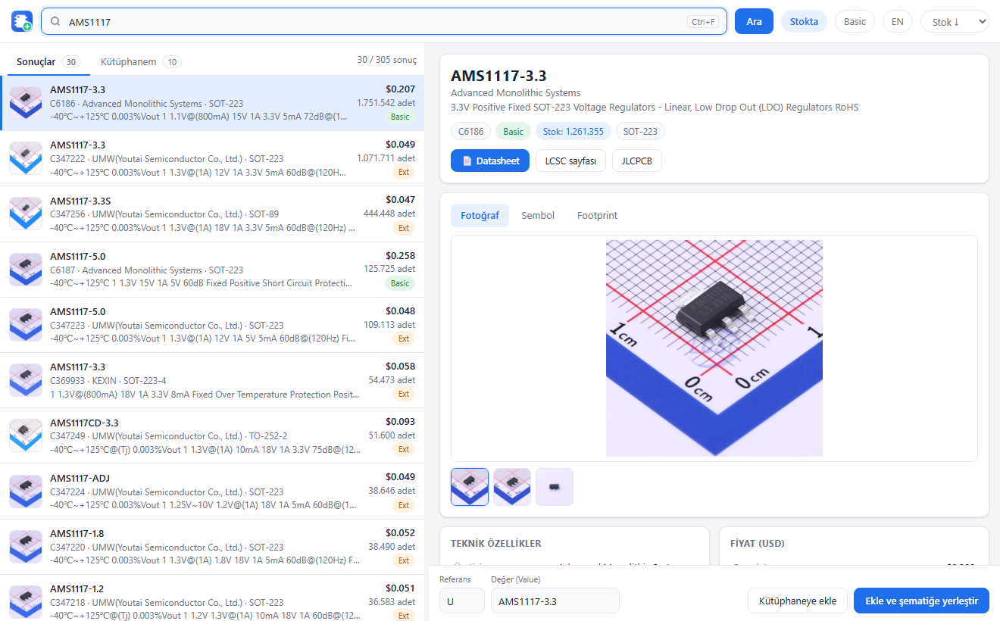
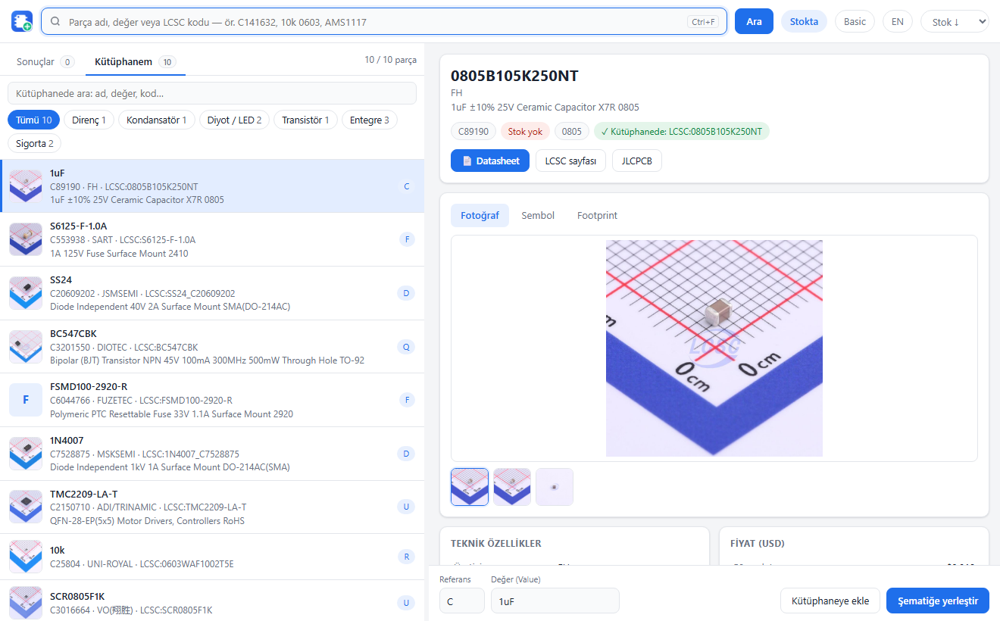

<p align="center"></p>

<h1 align="center">LCSC Parça Ekle — KiCad 10 eklentisi</h1>

<p align="center"><a href="README.md">English</a> · <b>Türkçe</b></p>

LCSC / JLCPCB parçalarını **fotoğraf, sembol ve footprint önizlemesi, teknik özellik, fiyat ve stok**
bilgisiyle arayın; tek tıkla KiCad kütüphanenize ekleyin ve şematikte **imlecinize yapışık** olarak
getirin. EasyEDA'daki parça ekleme deneyimini KiCad'e taşır.



## Özellikler

- **Arama:** parça adı (`AMS1117`), değer + kılıf (`10k 0603`) ya da LCSC kodu (`C141632`).
  Stokta / Basic filtreleri, stok ya da fiyata göre sıralama.
- **Detay paneli:** fotoğraf galerisi, sembol ve footprint önizlemesi, teknik özellikler, kademeli
  fiyat tablosu, datasheet / LCSC / JLCPCB bağlantıları.
- **Tek tıkla yerleştirme:** parça `LCSC` kütüphanesine eklenir (sembol, footprint, 3B model),
  şematik editörü öne gelir ve sembol imlece yapışık gelir; tıklayıp bırakın.
- **Kütüphanem:** eklediğiniz parçalar resimleriyle listelenir; **Direnç, Kondansatör, Diyot,
  Transistör, Entegre…** türlerine göre filtreleyip arayabilir, indirmeden anında yerleştirebilirsiniz.
- **Çizimi olmayan parçalar:** EasyEDA'da sembolü/footprint'i olmayan bir kod seçerseniz, aynı
  parçanın çizimi olan diğer LCSC kodları önerilir.
- **Türkçe ve İngilizce** arayüz (KiCad / Windows diline göre açılır, `EN`/`TR` düğmesiyle değişir),
  açık/koyu tema, klavye ile kullanım (`Ctrl+F`, `↑ ↓`, `Enter`).



## Gereksinimler

- **KiCad 10** (Windows)
- İnternet bağlantısı (LCSC/JLCPCB ve EasyEDA'dan veri çekilir)

Ayrıca Python ya da başka bir şey kurmanız gerekmez; eklenti ihtiyaç duyduğu paketi
(`easyeda2kicad`) ilk açılışta KiCad üzerinden kendisi kurar.

## Kurulum

1. **KiCad API'sini açın:** KiCad ana penceresinde **Tercihler → Tercihler… → Eklentiler**
   sayfasında **"KiCad API'sini Etkinleştir"** kutusunu işaretleyip **Tamam**'a basın.
2. **Paketi indirin:** [Releases](https://github.com/recepuysal/kicad-lcsc-importer/releases/latest)
   sayfasından `kicad-lcsc-importer-x.y.z.zip` dosyasını indirin. **Zip'i açmayın.**
3. **Kurun:** KiCad ana penceresinde **Araçlar → Eklenti ve İçerik Yöneticisi** → sol alttaki
   **Dosyadan Yükle…** → indirdiğiniz zip'i seçin.
4. **KiCad'i kapatıp yeniden açın.** İlk açılışta KiCad eklentinin Python ortamını hazırlar
   (birkaç saniye ile bir dakika arası sürebilir, internet gerekir).
5. Şematiği açın; üst araç çubuğunun sağ ucunda **LCSC** düğmesi görünür.

İlk çalıştırmada `Belgeler\Kicad\LCSC` altında `LCSC` sembol ve footprint kütüphanesi
oluşturulur ve KiCad'e otomatik tanıtılır. Footprint'lerin PCB tarafında görünmesi için
KiCad'i **bir kez daha** yeniden başlatın (ekranda bununla ilgili bir uyarı çıkar).

## Kullanım

1. Şematikte **LCSC** düğmesine basın (pencere zaten açıksa öne gelir).
2. Parçayı arayın, listeden seçin; sağda fotoğraf, sembol, footprint ve özellikleri görün.
3. Gerekirse **Referans** (R, C, U…) ve **Değer** alanlarını düzenleyin.
4. **Ekle ve şematiğe yerleştir** (ya da `Enter`): sembol imlecinize gelir, tıklayıp bırakın.
   Vazgeçmek için `Esc`.
5. **Kütüphaneye ekle** yalnızca kütüphaneye ekler; şematikte `A` tuşuyla `LCSC:` altında bulursunuz.

## Sorun giderme

| Sorun | Çözüm |
|---|---|
| Araç çubuğunda LCSC düğmesi yok | Tercihler → Eklentiler'de API açık mı? KiCad'i yeniden başlatın. İlk açılışta ortam kurulumu birkaç saniye sürer. |
| "easyeda2kicad bulunamadı" | İlk açılıştaki kurulum tamamlanamamış olabilir (ör. internet yok). Eklenti ve İçerik Yöneticisi'nden eklentiyi kaldırıp yeniden kurun. |
| "Bu parçanın KiCad çizimi yok" | Parçanın EasyEDA'da çizimi yok. **Çizimi olan alternatifleri bul** düğmesini kullanın. |
| "… istekleri sınırlıyor (HTTP 403)" | JLCPCB arama servisi geçici olarak sınırlıyor. Birkaç dakika bekleyin; LCSC koduyla arama bu sırada da çalışır. |
| Sembol imlece gelmedi | Şematik editörü açık olmalı. Açık değilse parça panoya kopyalanır, şematikte `Ctrl+V` ile yerleştirin. |

Hata kaydı: `%LOCALAPPDATA%\lcsc_importer\lcsc_importer.log`

## Geliştirme

```
plugin/            KiCad'e kurulan eklenti (plugin.json, launch.py, lcsc_importer/)
pcm/metadata.json  Eklenti ve İçerik Yöneticisi paket bilgisi
build.py           dist/kicad-lcsc-importer-<sürüm>.zip üretir
art/logo.svg       logo kaynağı
```

Parça içe aktarma [easyeda2kicad](https://github.com/uPesy/easyeda2kicad.py) ile yapılır.
Bu proje LCSC, JLCPCB ya da EasyEDA ile bağlantılı değildir.

## Lisans

MIT
